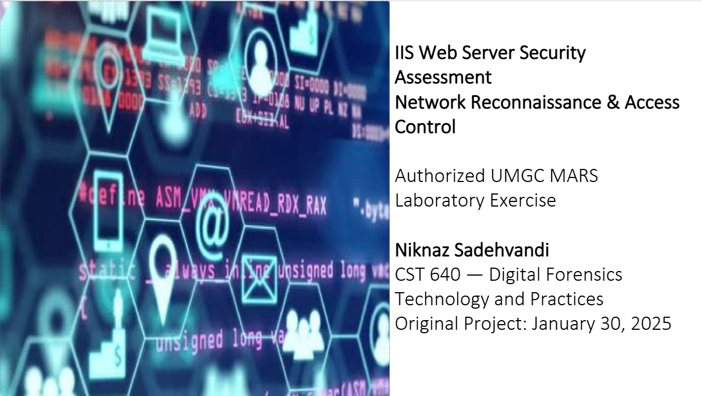

# Network Security Assessment – IIS Web Server Lab

## Overview

This project documents a simulated web server security assessment completed in the University of Maryland Global Campus (UMGC) MARS laboratory.

The assessment explores Windows account administration, web directory discovery, Base64 encoding, and security configuration risks using Linux and Windows systems.

**Project Type:** Academic Cybersecurity Lab  
**Date:** January 2025  
**Focus:** Network Security, Web Server Assessment, Security Misconfigurations

## Why This Project Matters to Security Teams

- Demonstrates how directory enumeration can identify accessible web resources.
- Examines potential security risks involving access controls and sensitive information.
- Reinforces the importance of secure web server configuration.
- Provides practical experience documenting security testing activities and results.

## Lab Environment

- **Platform:** UMGC MARS virtual laboratory
- **Systems:** Kali-based Linux and Windows
- **Web Server:** Microsoft Internet Information Services (IIS)
- **Tools Demonstrated:** Dirb, Windows Command Prompt, CyberChef, Windows security settings
- **Additional Lab Tools:** Nmap and Nikto

## Technical Activities

### 1. Laboratory Configuration

Reviewed network configurations for the Linux and Windows systems within the MARS environment.

Documented the network addressing and system configurations used during testing.

### 2. Windows Account Administration

Used Windows command-line utilities to create a test account and add it to the local Administrators group.

This exercise demonstrated how account permissions and administrative privileges are configured.

### 3. Base64 Encoding

Used CyberChef to demonstrate Base64 encoding and examine how information can be represented in encoded form.

Base64 is an encoding mechanism, not encryption, and does not protect sensitive information from unauthorized disclosure.

### 4. Web Directory Discovery

Created a test directory and webpage within the IIS web root.

Used Dirb to perform directory enumeration against the laboratory web server.

The successful scan identified an accessible `/hidden/` directory and returned a successful HTTP response for its test webpage.

An earlier scan against a different lab address failed to establish a connection.

### 5. Security Configuration Review

Examined Windows password security settings and the implications of administrative access.

Discussed how insecure account permissions and exposed web directories can contribute to security risks.

## Findings

- Demonstrated successful creation and discovery of a test web directory.
- Observed how directory enumeration identifies accessible web resources.
- Demonstrated Windows account creation and administrative group membership.
- Explored Base64 encoding and the importance of protecting sensitive information.
- Identified security considerations relevant to access controls and web server configuration.

## Assessment

The laboratory activities demonstrated how security testing tools can identify accessible resources and help evaluate system configurations.

The exercise did not establish a real-world compromise or independently confirm malicious activity.

## Recommended Security Practices

- Restrict access to sensitive web directories.
- Apply least-privilege permissions.
- Enforce appropriate password and account security controls.
- Review web server configurations and access permissions.
- Monitor web requests for suspicious enumeration activity.

## Project Evidence

The original academic presentation includes screenshots of the Windows and Linux environments, administrative commands, CyberChef exercises, IIS directory configuration, and Dirb scan results.

**[View IIS Security Assessment](Niknaz_Sadehvandi_IIS_Security_Assessment.pdf)**

## Skills Demonstrated

- Web Server Security Assessment
- Network and Directory Enumeration
- Windows Account Administration
- IIS Configuration
- Linux Security Tools
- Base64 Encoding
- Security Documentation
- Technical Findings Interpretation

## Author

**Niknaz Sadehvandi**  
M.S. Cybersecurity Technology | CompTIA Security+

[LinkedIn](https://www.linkedin.com/in/niknaz-sadehvandi-a34179325/)
